# Android medication reminder flow

This walkthrough documents the Android-first reminder flow and its native home-screen widget. Every screenshot was captured from the `JananCapture` Android Virtual Device, configured from a Pixel 10 Pro profile. The selected device was `emulator-5554`, logical display 0, at 1280 × 2856. No physical phone was used for these captures. The product scope is in the [Medication reminders plan](medication-reminders-plan.md).

The example uses demo data: Amlodipine 5 mg at 8:00 AM on weekdays. The sample dose is marked Taken only to demonstrate the recorded-dose and widget states.

## Medication navigation

The medication area now has three persistent tabs: **Today**, **Reminders**, and
**Medicines**. Swipe between them or tap a tab. Switching preserves the selected
day and does not push another
screen. Back returns to the screen from which the medication area was opened.

- The home calendar and notification/widget routes open **Today**.
- The reminder setup route opens **Reminders**. Tap a card to edit, use its switch
  to pause/resume, and use its labeled overflow menu to edit or end a reminder.
  Ending still requires confirmation and preserves dose history.
- Settings → Manage medications opens **Medicines**. Each medicine has an
  **Add reminder** action that preselects it in the schedule editor; edit/delete
  actions are in the medicine's overflow menu.
- The header bell opens notification permission and exact-timing settings.

Within the tabbed area, horizontal swipes change screens. Use the daily log's
date arrows or calendar to browse history. The standalone daily log retains its
day-swipe behavior.

The walkthrough screenshots below predate this navigation update. Reminder
scheduling, dose actions, and widget behavior are unchanged.

## Build and setup

### Select the emulator for capture

1. Call PolyScreen `mobile_devices_list` and select the device whose serial is `emulator-5554` and product is `sdk_gphone64_x86_64`.
2. Call `mobile_displays_list` with serial `emulator-5554`; select logical display `0` (`Built-in Screen`, 1280 × 2856, portrait).
3. Pass both `serial: emulator-5554` and `displayId: 0` to app launch, UI input, UI inspection, and screenshot capture calls. If another device is listed, keep this capture session on `emulator-5554`.
4. Use PolyScreen for every visible interaction and screenshot. Use Flutter/PolyScreen or ADB only to build, install, and diagnose the app.

From the repository root:

```sh
fvm flutter pub get
fvm flutter build apk --debug
```

The APK is written to `build/app/outputs/flutter-apk/app-debug.apk`. Launch it on the emulator with `fvm flutter run -d emulator-5554`, or install the APK through PolyScreen or `adb install -r build/app/outputs/flutter-apk/app-debug.apk`.

On first launch, complete onboarding or tap **Skip** before opening reminders.

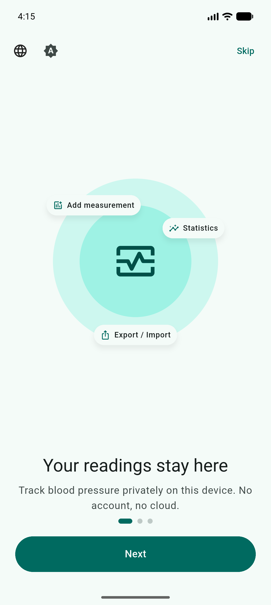

The first saved schedule requests Android notification permission. Grant it to receive operating-system reminders. On this Android 36 emulator, Janan then opened the **Alarms & reminders** setting for exact timing. Enable **Allow setting alarms and reminders** if you want exact alarms; Janan falls back to inexact timing when access is unavailable. The in-app agenda and dose actions remain available if notification permission is denied.

Schedules and dose occurrences are stored in the local `health.db`. Android notifications are rebuilt from active schedules on app startup and after schedule changes. The native widget displays a compact summary written by the app; it does not read the PowerSync database directly.

## Check the next-dose countdown

The blood-pressure home tab places a compact 56 dp countdown circle, matching the Add measurement FAB, where the medicine FAB used to sit. There is no separate medication card in the dashboard body. The circle uses the selected medicine color; its center shows whole hours or minutes (`2h`, `58m`) without seconds. The active countdown omits the pill icon and routine “Next dose” caption; near doses retain their label, while overdue time shows the red ring and elapsed countdown (`+10m`) without a separate “Overdue” caption. The medicine name scales down to fit the available center space. The ring advances as the dose approaches; amber marks the final hour.

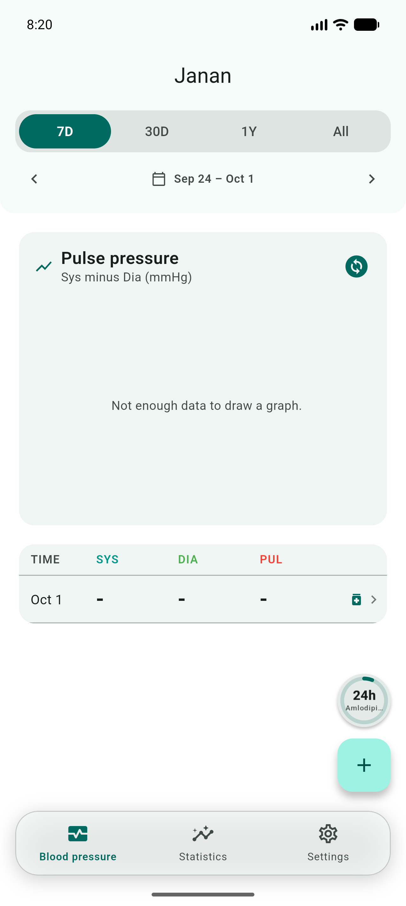

Tap the circle to open its attached dose panel. The panel grows upward from the circle, keeps its edge aligned to the control, and dims the rest of the screen. Its header shows **Next dose** and the number of doses recorded today. The compact medicine-colored dose card shows the medicine and amount, scheduled time and current status, then equal-width **Done**, **+10m**, and **Skip** actions. A **Next up** section lists the following doses in compact, tappable rows. **Log Manual Dose** and **Calendar** sit side by side at the bottom. After a medicine is marked Taken, its next occurrence stays out of the action card until it is within four hours of its scheduled time; during that quiet period a short taken/next-time summary replaces the card. This is checked per occurrence, so a dose scheduled every two hours remains visible when the next dose is within four hours.

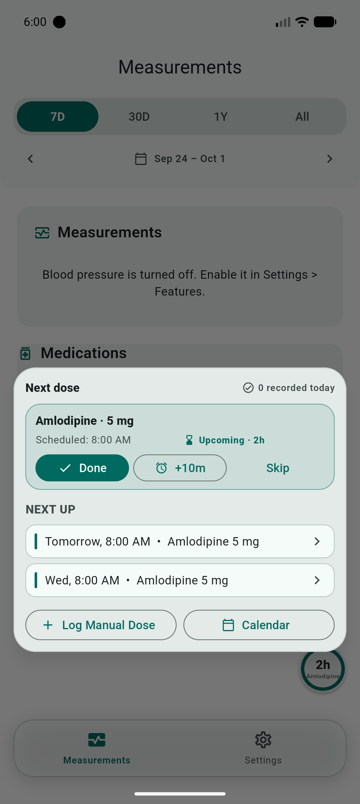

This screenshot was captured on the `emulator-5554` Android emulator with its clock temporarily set to 6:00 AM on a scheduled dose day, so the 8:00 AM dose appears as upcoming in 2h. Automatic date and time was restored after capture.

The Bluetooth launch-sync popout follows the same interaction pattern: its status indicator anchors the panel, the panel fades and scales out from that point, and a dim barrier covers the rest of the app. Tapping outside or closing the panel dismisses it. The emulator has no paired, saved Bluetooth meter, so this walkthrough does not include a live Bluetooth-sync screenshot.

## Create a reminder and record a dose

### 1. Open the reminder list from the countdown

Tap **Today's medicines** in the attached dose panel. With no active schedules, the circular control opens a setup panel with an **Add reminder** action.


### 2. Start from the empty schedule list

The empty state explains that a reminder uses an existing or newly added medicine. Tap **Add reminder**.

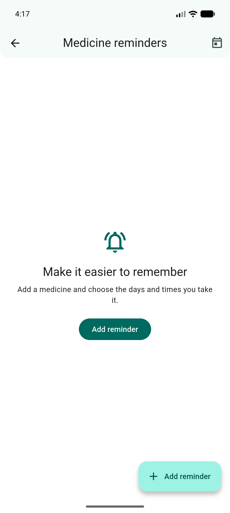

### 3. Open the schedule form

The form collects medicines, dose amounts, times, weekdays, and optional start and end dates.

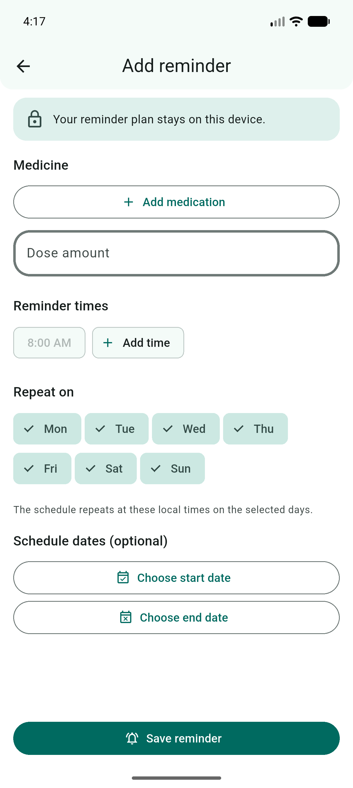

### 4. Choose or add a medicine

Tap the medicine field, then choose an existing medicine or add one from the picker.

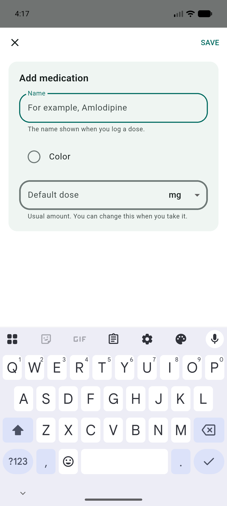

### 5. Set the dose and time

Choose the dose amount and reminder time. This example uses Amlodipine 5 mg at 8:00 AM.

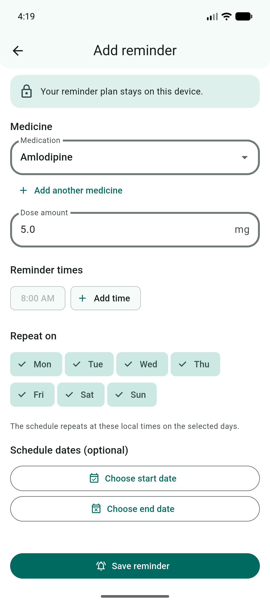

### 6. Choose recurrence days

Select the weekdays for the schedule. The example selects Monday through Friday. Start and end dates can limit the schedule to a date range.

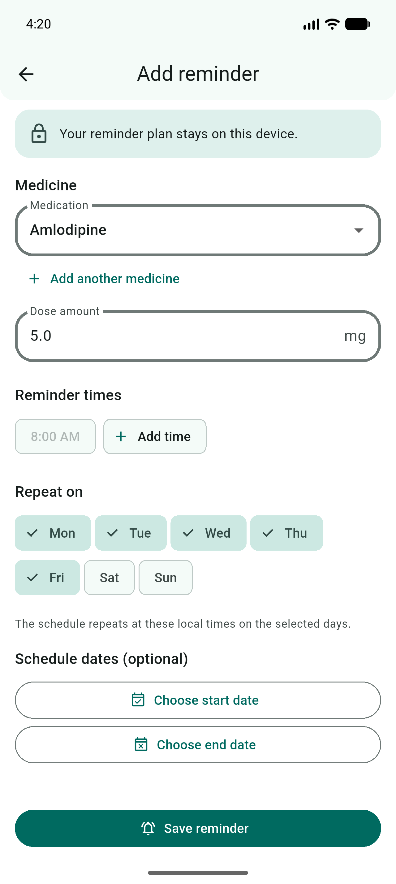

### 7. Allow notifications

Save the schedule and respond to Android's notification permission prompt. If Android opens the exact-alarm setting, enable it there or return to Janan to continue with inexact timing.

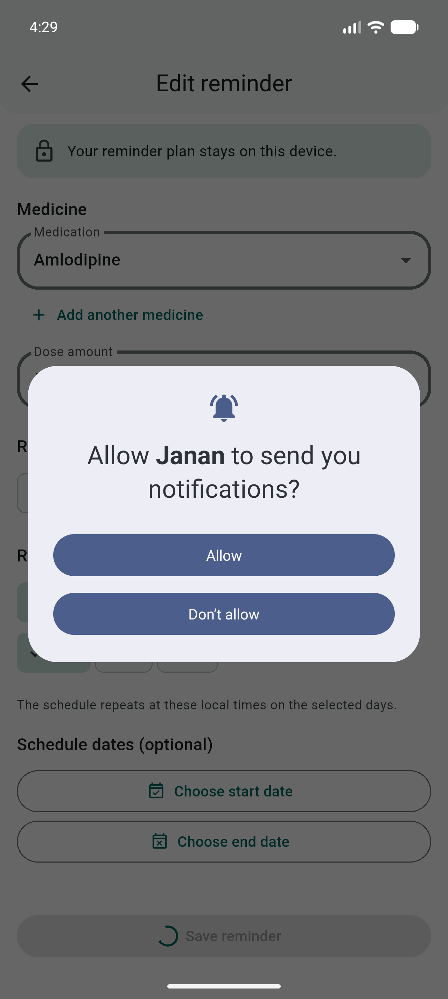

Android opened the exact-alarm setting after the notification prompt on this emulator. The setting is optional; returning without enabling it uses inexact timing.

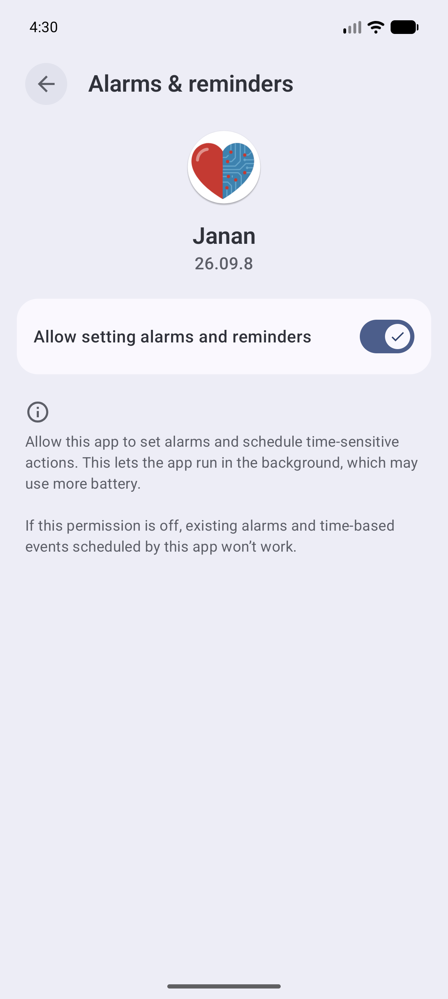

### 8. Review the saved schedule

The schedule list shows the medicine, dose, time, recurrence, and active state. From here, edit or pause the reminder, or open today's agenda.

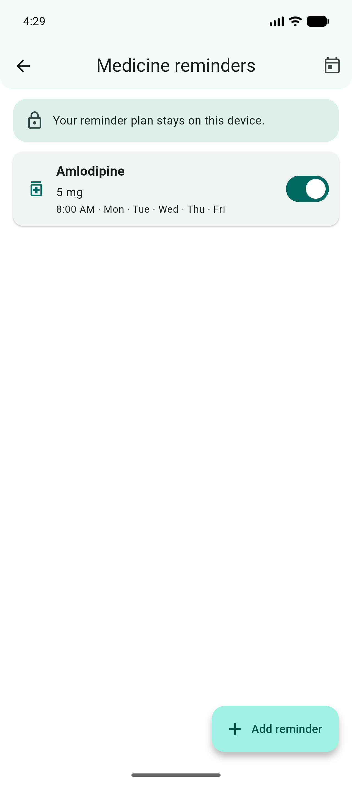

### 9. Open today's agenda

Tap **Today's medicines** in the attached home panel or choose the **Today** tab
in the medication area. Upcoming doses appear in time order with their current
status.

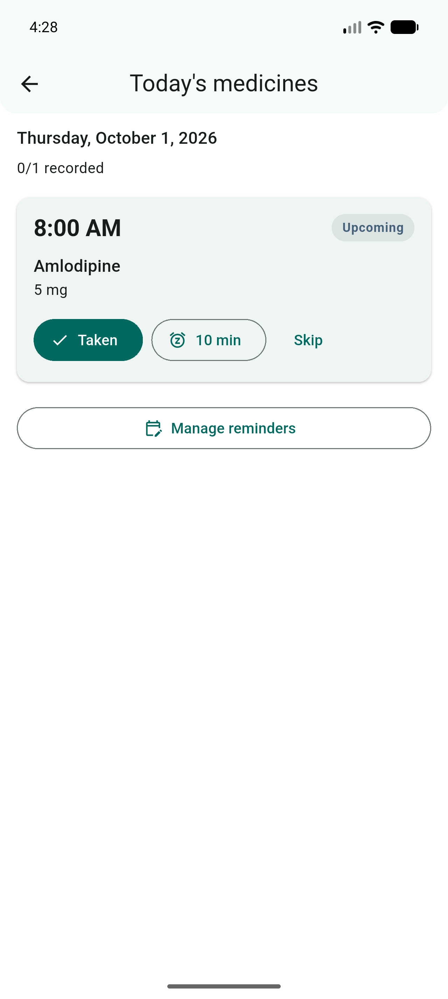

### 10. Snooze a dose

Tap **10 min** on a pending dose. Janan records the snoozed state and schedules a follow-up notification for the snooze time. Snoozing does not record an intake as Taken.

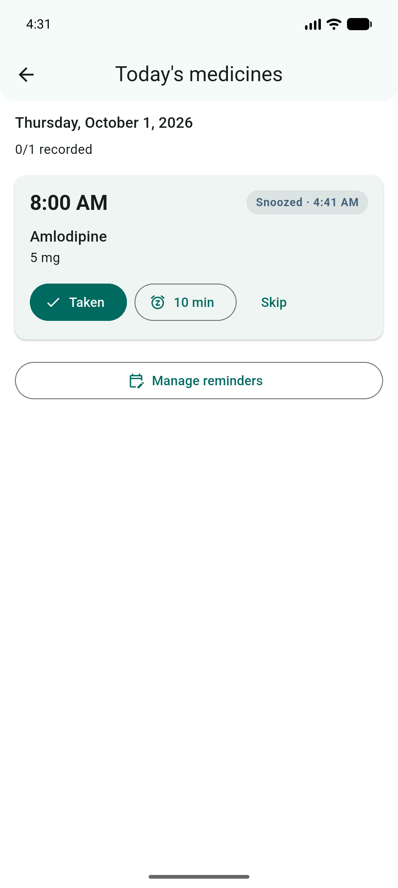

### 11. Record the dose as taken

Tap **Taken** when the dose has actually been taken. Janan records the dose and links the intake to the planned occurrence. The agenda updates its recorded count.

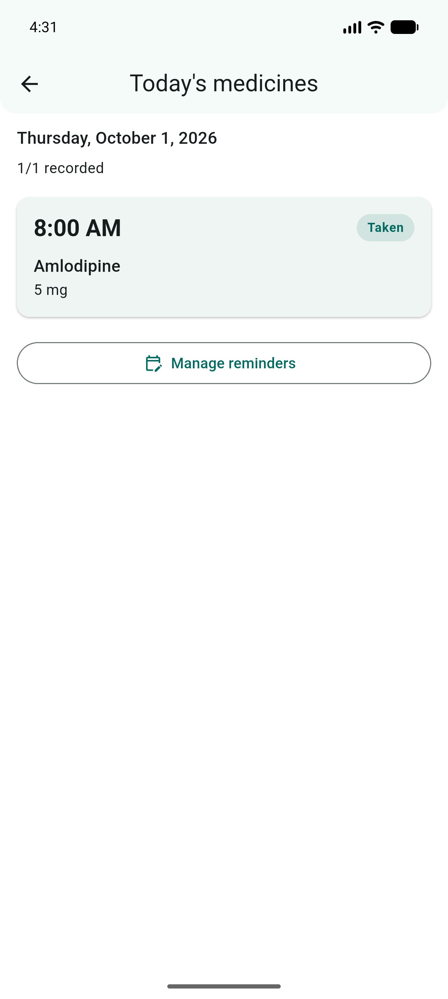

## Add and use the Android widget

The home-screen widget is a native Android app widget sized to one launcher icon cell. It uses the same medicine color and countdown state as the in-app circle. It shows whole hours or minutes without seconds; scheduled refreshes update the ring and label at countdown boundaries, the one-hour threshold, and the dose time.

### 12. Find Janan in the widget picker

Long-press an empty area of the Android home screen, open **Widgets**, search for **Janan**, and drag its circular one-cell countdown onto the home screen. The preview can show placeholder text until the widget instance is placed.

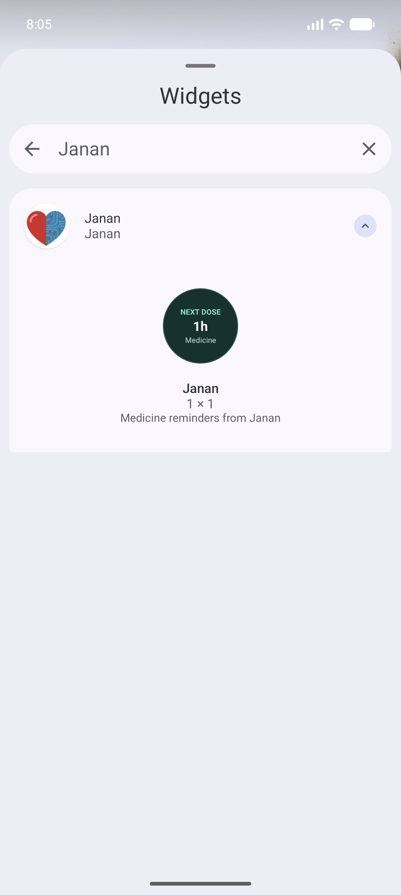

### 13. Review the placed widget

The placed widget shows the next medicine, an hours-or-minutes countdown, and the medicine-colored progress ring. Tap outside the placement outline to finish.

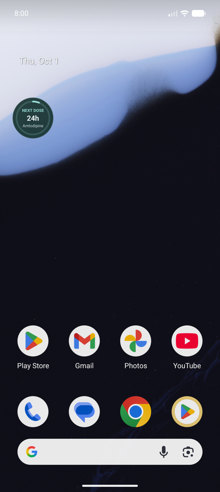

### 14. Open today's agenda from the widget

Tap the circle. Janan opens today's agenda with the next dose state. The widget itself is read-only.

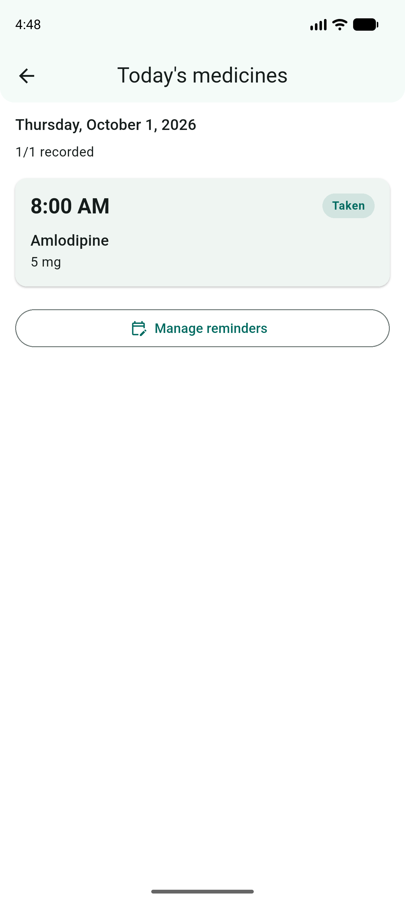

## Capture the near-dose and overdue states

These state examples use the saved weekday schedule for Amlodipine 5 mg at 8:00 AM. Change the emulator clock through Android **Settings → System → Date & time**; leave any other device untouched.

1. Turn off **Set time automatically** and set the emulator to **October 2, 2026, 7:02 AM**. Open Janan and capture the amber `58m` in-app state as `20-home-near-dose.png`. Cold-launch Janan through PolyScreen to refresh its widget summary, press **Home**, and capture the launcher widget as `22-widget-near-dose.png`.
2. Set the emulator to **October 5, 2026, 9:05 AM**, when the next weekday 8:00 AM dose is overdue by about an hour. Cold-launch Janan through PolyScreen, capture the red overdue circle as `21-home-overdue.png`, press **Home**, and capture the widget's elapsed-time state as `23-widget-overdue.png`.
3. Turn **Set time automatically** back on. Cold-launch Janan once, then return to the launcher and confirm the widget reflects the current next dose.

The ring advances as the dose approaches. Within one hour, the label and ring turn amber; after the scheduled time, they turn red and the center switches to elapsed time with a `+` prefix. Both surfaces show hours or minutes only (for example, `58m` and `+5m`), never seconds.

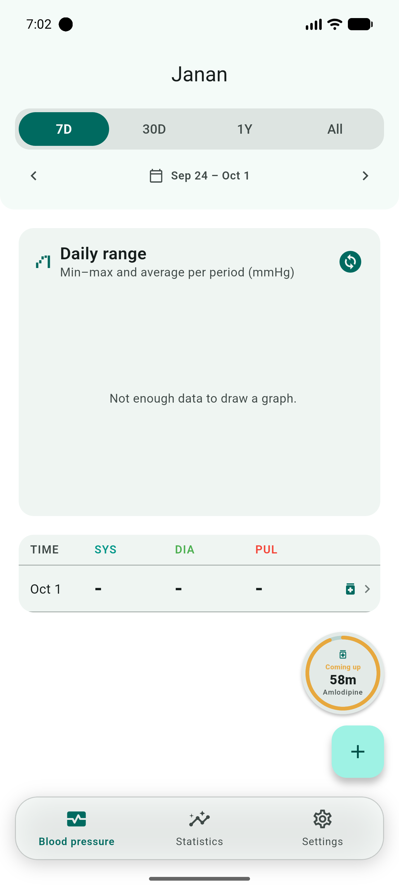

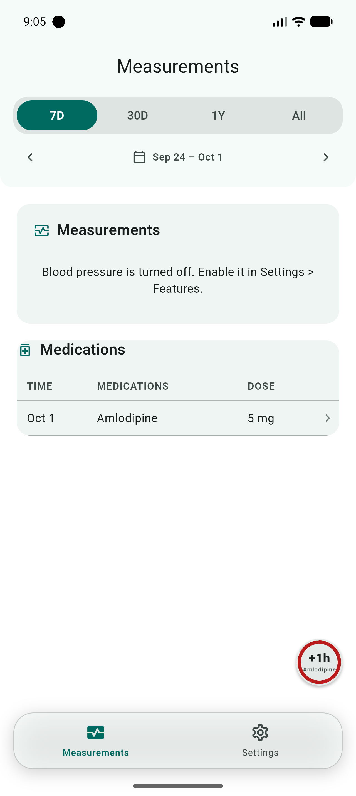

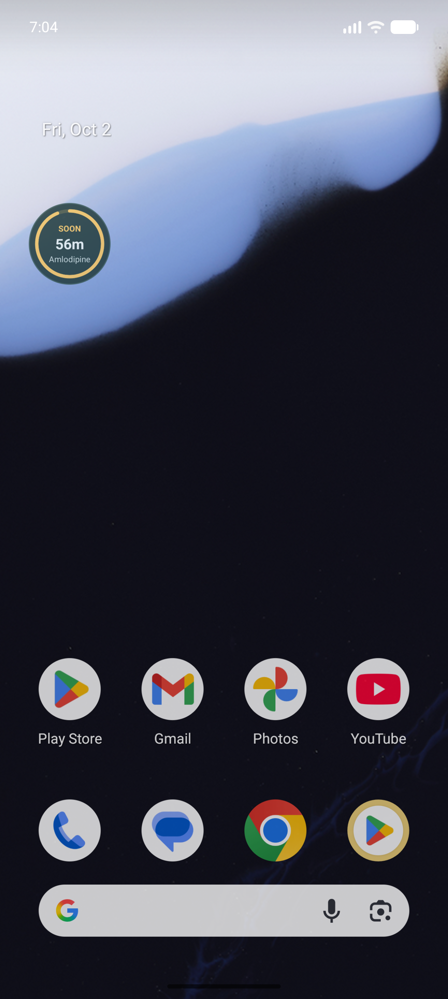

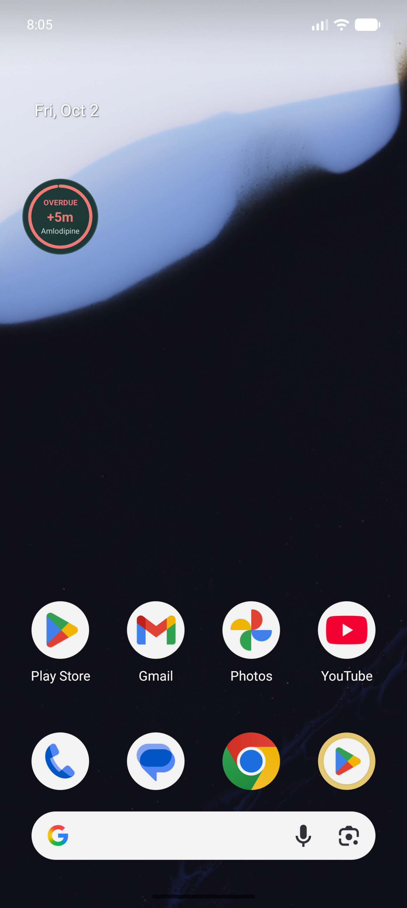

## Capture and validation notes

- Target: `JananCapture` AVD based on the Pixel 10 Pro profile, Android 36.1 Google Play image, device model `sdk_gphone64_x86_64`, serial `emulator-5554`.
- Captures use logical display 0 in portrait at 1280 × 2856 and 480 dpi. UI interaction, date/time setup, launcher widget placement, and screenshots use PolyScreen with that exact serial and display ID.
- `fvm flutter build apk --debug` completed, and the APK was installed without clearing emulator app data. The countdown and attached panel were exercised on the emulator through PolyScreen.
- The app was cold-launched through PolyScreen to refresh the native widget after restoring automatic date and time. ADB was used earlier for build/install diagnostics and `am kill` to simulate a stopped background process while retaining the launcher's cached widget view. All visible screen interaction was performed through PolyScreen.
- The widget's **OPEN TODAY** route was manually verified after the process kill; the final capture shows the Today agenda and the saved Taken state.
- The demo schedule was marked Taken during the walkthrough. It is sample data, not a statement that anyone took the medicine.

### Navigation update validation (October 21, 2026)

- Full test suite: 782 passed. Medication/settings/localization checks: 89 passed.
- All seven golden tests passed. The reminder list was also reviewed under
  system dark mode; the emulator's original light-mode setting was restored.
- Navigation regression coverage includes one-step Back behavior, retaining the
  selected day, opening a reminder with its medicine selected, cancellation of
  the end confirmation, and English/Arabic portrait/landscape at 1.6× text.
- Analyzer passes with 21 existing informational findings. Debug APK built and
  installed on `emulator-5554`, logical display `0`, without clearing app data.
- PolyScreen verified all three tabs on the emulator. No raw ADB UI fallback was
  used; the settings page-index trigger required screenshot-based coordinates
  because its semantic tap plan pointed to the middle of the screen.
- Captures: Medicines `mobile://artifacts/display-0-1792549595963-27cf73ce-75a6-4ab3-bf11-21bbf2d749dc.png`,
  Reminders `mobile://artifacts/display-0-1792549608294-139806d5-4342-4b48-9916-5f64fcd88dd5.png`,
  Today `mobile://artifacts/display-0-1792549622287-040d45e0-b10d-4c6f-9256-4323ddef7ef7.png`.

### Reminder task restoration validation (October 24, 2026)

Android keeps a task's original launch intent after killing its background
process. FlutterFragment also saves the widget's `route` extra as its initial
route. Clearing only the intent leaves that saved fragment route able to
override the app's normal startup destination. MainActivity now resets both
when recreating a reminder-launched activity from saved state. Fresh reminder
launches still open Today; reopening the old task follows normal startup
settings (Home by default).

Regression procedure on `emulator-5554`, logical display `0`, with onboarding
completed and **Start with Add measurement page** disabled:

1. Tap the native reminder widget and confirm Today opens.
2. Navigate back to Home, then open Settings. Press Android Home and wait for
   the launcher widget to appear.
3. Record `adb -s emulator-5554 shell pidof com.shenepoy.janan.debug`, then run
   `adb -s emulator-5554 shell am kill com.shenepoy.janan.debug`.
4. Reopen Janan through PolyScreen `mobile_app_launch`. Confirm the process ID
   changed, Measurements is visible, and the Today medication tabs are absent.
5. Repeat with a notification launch. Also check that a fresh notification
   launch after process death opens Today instead of being treated as a resume.

The tool-driven regression failed before the fix (Today visible after a new
process started) and passed afterward for widget and notification tasks. The
debug APK built successfully, and 14 medication runtime/navigation tests passed.
Android fragment restoration requires the emulator check; Flutter widget tests
alone do not cover it.

Device UI interaction and assertions used PolyScreen semantic tools. ADB was
used for installation, process diagnostics and `am kill`. The notification
check used an ADB UI fallback to deliver the plugin's `SELECT_NOTIFICATION`
intent with notification ID `0`, because PolyScreen's launch tool cannot set
custom actions/extras; this checked routing, not notification delivery. No
reminder schedules or dose records were changed.

### Calendar tab and startup Back behavior (October 25, 2026)

The daily dose tab is now labeled **Calendar**, using the existing translated
calendar label. Calendar, Reminders, and Medicines remain tabs in one screen.
Reminder startup explicitly builds Home plus the requested calendar screen:
Flutter's default expansion of `/medications/today` previously added a second
medication screen for `/medications`, so Back incorrectly appeared to switch
from Calendar to Reminders. The navigation regression now checks that one Back
returns directly Home, alongside tab/date retention and English/Arabic layout
coverage.

Validation: 17 focused tests passed and the changed Dart files passed analysis.
The debug APK was installed on `emulator-5554`, display `0`; PolyScreen confirmed
the widget opens **Calendar** and a single Android Back returns to Measurements.
The launcher hierarchy could not become idle while its widget animated, so the
widget tap used its position from a PolyScreen screenshot. Calendar and Home
were verified through semantic accessibility matches. No ADB UI fallback was
used for this check.

### Enable/disable processing (October 25, 2026)

Changing a reminder now disables its switch, edit action, and action menu while
showing a progress indicator. The pending state belongs to the app's provider
scope, so leaving and reopening the screen cannot submit the same change twice.
The row stays in place until processing finishes, then reflects the stored
state. Save and refresh failures release the controls and show an error.

Alarm scheduling/cancellation and widget updates use one serial Android
background task queue. Permission requests, initialization, and other
Activity-dependent notification calls are dispatched to the main thread.
The Dart rebuild queue also releases its completed tail, including after an
error, so later rebuilds can proceed.

The regression command is:

```sh
fvm flutter test --no-pub test/features/medications/medication_schedule_toggle_test.dart
```

Before the change, both pause and resume checks failed because the pending
switch still had an enabled callback. The checks now cover pending writes,
pending refreshes, repeated taps, failures, and leaving/reopening during work.
Android handler tests additionally check worker execution for alarm methods and
main-thread dispatch for permission/Activity methods.

On `emulator-5554`, display `0`, a temporary probe measured about 0.66 seconds of
main-thread work for the first 100 alarms during a pause. After the change, the
same alarm work logged `main=false`. PolyScreen captured the disabled switch
and spinner while enabling a reminder:
`mobile://artifacts/display-0-1792877535003-0e51abbe-3204-4c27-b920-f1eba0103be3.png`.
The timing probes were removed afterward. ADB was used for build/install and
logs; screen input and validation used PolyScreen. The sample reminder's
original enabled state was restored.

Final validation passed: 19 focused Flutter tests, two Android handler tests,
analysis of the changed Dart files, and the debug APK build. With the final APK,
PolyScreen verified pausing, switching to Calendar immediately after starting
the update, returning to Reminders, and enabling the reminder again.

### Reminder card movement (October 25, 2026)

After a state change finishes, the card now slides, fades, and subtly scales
into its new group over 360 ms. The surrounding rows ease into the space it
leaves. Re-enabling plays the reverse direction. Outgoing cards ignore input
and are excluded from accessibility so there are no duplicate actions during
the transition. Reduced-motion mode skips the transition.

Validation: 18 focused tests, changed-file analysis, and the debug APK build
passed. PolyScreen recorded a pause/resume cycle on `emulator-5554`, display
`0`, and the sample medicine was returned to its original active state. Motion
was reviewed from the recording:
`mobile://artifacts/recording-1792878250851-0-f4e93f6b-1fd4-4daf-a9f3-5fd9910a2f7b.mp4`.

### Recording old doses (October 25, 2026)

An unrecorded dose at least 24 elapsed hours past its scheduled time now offers
**Taken** and **Skip**, without Snooze. The Calendar and reminder panel share
this rule. Taken passes the original scheduled time plus exactly one hour to
the repository, which atomically saves the intake and updates the original
occurrence. The original scheduled date and occurrence link remain intact.
Repeating Taken preserves the first saved recording time. Current doses keep
their existing Snooze action and current-time recording behavior.

The exact one-hour offset can cross midnight for late-night slots; the intake
timestamp then falls on the next date, while Calendar completion belongs to
the original scheduled dose.

Validation: 76 focused Flutter tests passed (two unrelated DST tests skipped),
changed-file analysis passed, and the debug APK built and installed. The new
tests cover the 24-hour boundary, historical Taken and Skip from Calendar,
current-dose behavior, and real database persistence without adding an intake
to today's history. PolyScreen verified the current three-button layout and
the historical two-button layout on `emulator-5554`, display `0`:
`mobile://artifacts/display-0-1792878986149-6e5290df-f549-4950-9a48-a20512744b65.png`.
The emulator check did not record any intakes; persistence was checked in a
temporary test database. ADB was used for build/install, with no ADB UI fallback.
